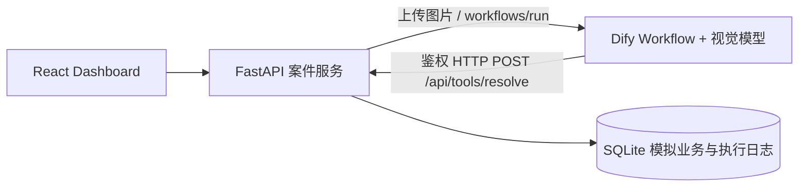

# 系统架构

浏览器同源 /api；Vite 开发代理与生产静态服务均连接 FastAPI。密钥不进入前端。
单进程 Demo：SQLite WAL + unique(order_id) 实现幂等，后台任务执行 Dify，异常归档人工。后台任务不跨重启持久排队，启动时将中断任务转人工，避免虚假成功。
Dify 负责多模态提取和工具编排；后端负责确定性政策校验、原子写入和回读；模型不可直接写申请状态。
表：orders、products、returns、cases、events。cases 存提取与结果；events 存调用耗时、成功/参数校验和错误；不存密钥/原始图片到 trace，图片仅用于 Dify 上传。
信任边界：Dify 工具 Bearer token；case_id 与工作流运行绑定的一次性随机执行 token；用户图片和模型输出均校验，不接收客户端传入政策/订单事实。前端无公网认证，部署前必须加身份验证与权限控制。

## Module 1部署候选更新
保留同源本地开发；Vercel独立前端通过公开的VITE_API_BASE_URL连接Railway后端，显式HTTPS CORS，不把服务端秘密编入浏览器。Railway Docker读取PORT、单worker，SQLite卷/data。公网模式采用私有操作者Bearer与独立工具Bearer，并默认禁止案件执行。单进程限流不是分布式配额系统。未进行真实云部署；部署与人工步骤见docs/module1-review.md。
