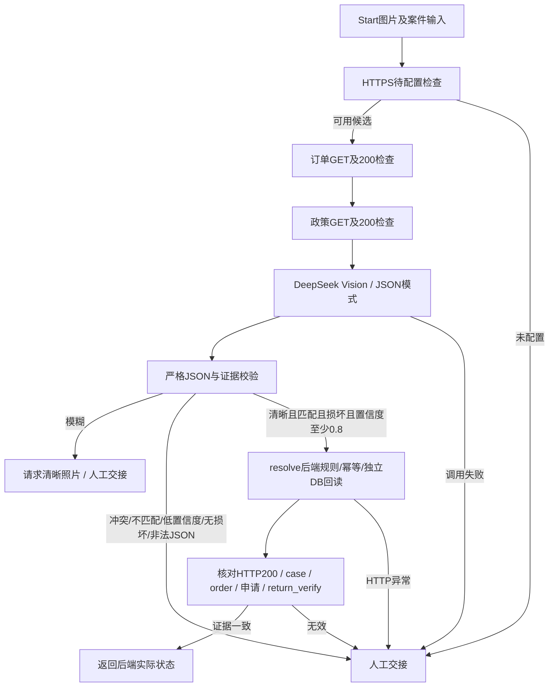

# RelayOps Dify 应用包修订：DeepSeek

## 修改范围与实际证据
本次只修改现有工作流生成器、DSL/应用包、工作流Code节点源码及测试/文档。没有重建项目、重做Phase 1–3、修改React或业务API，也没有部署、发布或推送GitHub。

官方来源：dify-official-plugins commit `b4df0da33f8e6f0f4cde7b9250f317c1d69e2bb5`。
- [manifest](https://github.com/langgenius/dify-official-plugins/blob/b4df0da33f8e6f0f4cde7b9250f317c1d69e2bb5/models/deepseek/manifest.yaml)：author=langgenius，name=deepseek，插件源码版本0.0.26。
- [provider](https://github.com/langgenius/dify-official-plugins/blob/b4df0da33f8e6f0f4cde7b9250f317c1d69e2bb5/models/deepseek/provider/deepseek.yaml)：provider=deepseek，组合真实节点标识为`langgenius/deepseek/deepseek`。
- [模型定义](https://github.com/langgenius/dify-official-plugins/blob/b4df0da33f8e6f0f4cde7b9250f317c1d69e2bb5/models/deepseek/models/llm/deepseek-flash.yaml)：model=deepseek-flash，mode=chat，features包含vision，response_format支持text/json_object，未声明structured-output特性。

用户已确认Cloud中安装并配置该Provider且可见VISION模型；Codex没有登录账号，不能独立确认当前安装版本、额度或真实模型运行结果。

## 模型与输出方式
由OpenAI/gpt-4.1-mini切换为DeepSeek/deepseek-flash。模型参数均取自官方声明：thinking=false、temperature=0、max_tokens=2048、response_format=json_object。禁用Dify原生Structured Output，不依赖不兼容的json_schema选项。

`workflows/parse_evidence.py`作为Dify Code节点嵌入包内：读取LLM.text，完整json.loads解析，拒绝重复键、NaN/Infinity、类型错误、缺字段、多字段和超长输出；布尔值不得用字符串代替。最多接受完整的```json代码围栏，不从任意描述中截取JSON。通过后将整个请求序列化，后端仍用Pydantic独立验证。

## 图片配置
Start.image为必填的单个file，仅允许local_file的PNG/JPEG/WebP；全局file_upload.enabled和image.enabled均启用，number_limits=1。Vision明确使用Start.image，High detail。后端上传协议不变：files/upload返回ID后，通过inputs.image传入local_file和upload_file_id；同一user用于上传与运行。开启配置不等于真实图片已通过Cloud模型实测。

## 分支与执行边界


订单/政策GET是只读事实查询，先于模型以提供商品参照。只有eligible分支能调用resolve；低质量/不匹配/低分不会进入该节点。模糊分支输出handoff + requested_action=provide_clear_photo，不冒充后端已持久化needs_information。

合格视觉证据只是初筛，不替代后端签收/政策窗口/商品可退规则。后端仍决定是否创建；同订单唯一约束、重复提交幂等和新数据库连接回读保持原样。后端可能返回handoff，这不是创建成功。

## 失败处理
- 配置检查拒绝空地址、非HTTPS、显式回环/私网IP、内网/invalid域名、userinfo和query；DNS实际路由及公网可达性仍需Cloud验证。
- LLM、订单/政策/resolve HTTP及关键Code节点均有fail-branch到人工路径。
- 订单/政策显式HTTP200条件，避免把错误正文送模型；LLM和只读HTTP最多1次节点重试，resolve不自动重试。既有后端的整次Workflow有限重试不变，因此真实运行次数/费用仍需观察。
- resolve后另有结果验证节点：核对case_id/order_id、HTTP200、created申请及匹配return_verify事件；不能仅靠模型文本或Workflow绿色状态确认成功。
- 无法确认时只报告handoff、未确认创建。若写入后响应丢失，申请可能真实存在，应查数据库，不得把未确认当作未发生；后端幂等性继续防止重复申请。

## 保持不改的后端行为及限制
现有适配器只认可已通过工具改变的后端状态。不调用resolve的早期人工/补图分支会被适配器安全降为handoff，保留通用“未调用核验工具”原因及workflow错误事件；Dify节点中可见具体补图/拒绝原因，但后端不会自动持久化这些新分支的全部解析字段。此次保持业务API和适配器源码不变，没有把这项限制伪装成已完成集成。

如以后要求前后端完整保留该类非执行结果，需要单独授权小范围适配器协议扩展；不能据此取消本次安全门槛或伪造执行成功。

## 必须在Dify Cloud手动完成
1. 导入新的workflows/relayops.ifpkg到专用测试Workflow；旧包/现有发布版不会被本地修改自动更新。导入版本迁移与节点兼容仍待实际验证。
2. 在视觉节点确认官方DeepSeek/deepseek-flash及现有凭据；Vision选择Start.image；原生Structured关闭，response_format=json_object，thinking关闭。无需把DeepSeek服务商Key交给Codex。
3. 设置BUSINESS_API_URL为受控且Cloud可达的HTTPS origin，本包中为空；设置Secret BUSINESS_API_TOKEN与服务端DIFY_TOOL_TOKEN一致。没有真实秘密写入包，导出时不得包含secret values。
4. 提供授权后的安全HTTPS网关，仅暴露必要工具路径；localhost不能回调。本次没有对外部署，也未替你发布应用。
5. 检查失败分支与证据门槛后，由你决定发布测试Workflow。后端DIFY_BASE_URL仍为Dify Cloud API地址，DIFY_API_KEY为该Workflow App Key，不是DeepSeek Key。
6. 从既有后端发起真实图片E2E，使用已有live_e2e.py与verify_case_db.py交叉核验。Stage单节点测试不要伪造案件execution_token。

## 包结构与验证
应用包仍为ZIP：仅manifest.yaml和app.yaml；format=dify.app、format_version=1，manifest的size及SHA256从本次app.yaml实际字节计算。代码节点源码已嵌入app.yaml，不需要在Dify另外上传Python文件。dependencies=[]，不编造Marketplace版本/哈希；已安装官方DeepSeek后在模型选择器确认。

73项本地Python测试通过，保留1项既有依赖弃用警告。覆盖包CRC、成员、size/SHA256、图分支、JSON/字段校验、负面证据不产生写请求、错误HTTP/回读证据拒绝，以及既有业务规则/幂等测试。Cloud导入、真实视觉和E2E尚未验证；本地契约测试不是远端运行证据。

交付状态更新：用户后续明确授权将DeepSeek新版及相关修改推送到原GitHub仓库，替换main中的旧包；此前未推送状态为历史记录。未授权Dify部署或发布。

最终包：5896字节，文件SHA256=`1b186b3e9966672f61c1e2f081f4a9d439dec65875010b5d9d9c64e771aa1bff`。此为整个ifpkg文件哈希；manifest里的哈希独立针对app.yaml，已测试二者各自正确。
